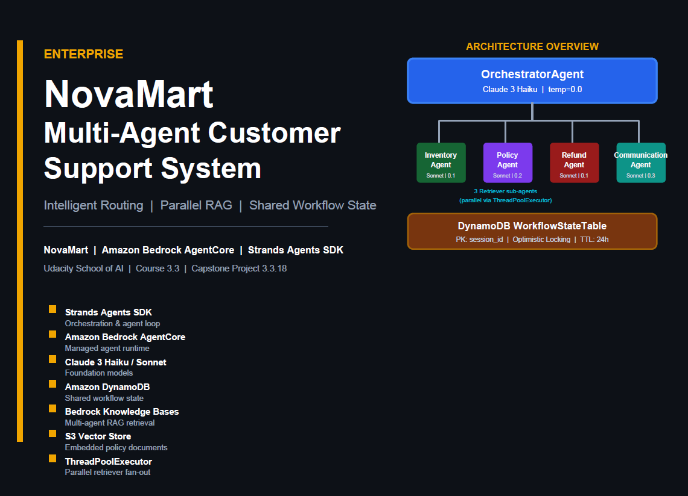
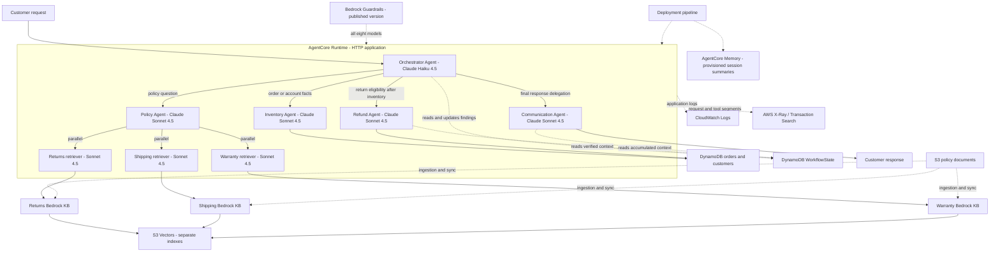
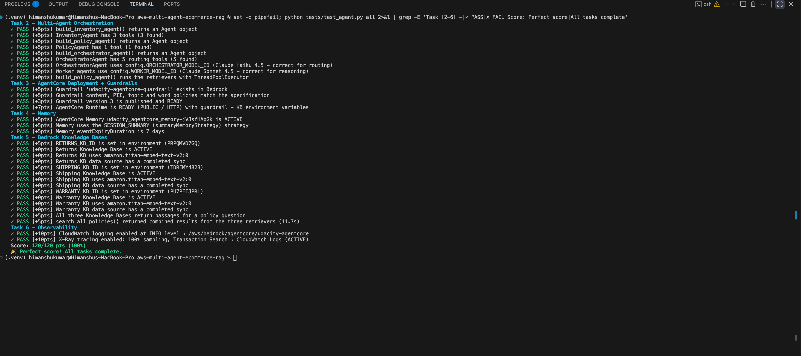
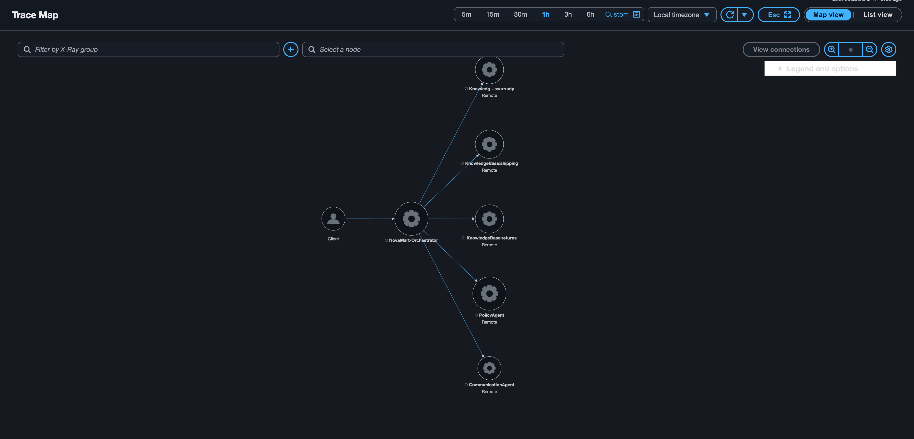

# NovaMart — Multi-Agent E-commerce Customer Support System

NovaMart is a fictional retailer used to explore how specialized AI agents can answer customer questions using verified order data and retrieved policy evidence. An orchestrator delegates work to inventory, policy, refund, and communication agents; the policy agent queries three Amazon Bedrock Knowledge Bases concurrently.

This educational implementation was developed for **Udacity's AWS Agent Engineer Nanodegree, Project 3: Multi-Agent E-commerce RAG**. It uses Strands Agents, Amazon Bedrock, and AgentCore Runtime rather than a custom agent framework or hosting server.

**Final verification: official Udacity suite 120/120 points; offline regression suite 28/28 tests.** Offline testing made zero AWS transport attempts. All 77 original assertion sites were preserved, with five new assertions added. The repository includes the [official-suite result](screenshots/10_full_test_suite_120_pass.png) and an [earlier AWS X-Ray Service Map](screenshots/11_xray_service_map.png). These are recorded evidence, not a guarantee that the AWS lab remains available.

## Key Features

- **Specialist delegation:** a Claude Haiku 4.5 orchestrator coordinates Claude Sonnet 4.5 workers and delegates the final reply to the Communication Agent.
- **Parallel multi-agent RAG:** Returns, Shipping, and Warranty retriever agents run through `ThreadPoolExecutor(max_workers=3)`. Each retrieves up to three passages per tool call, including source references and relevance scores.
- **Shared workflow state:** DynamoDB stores session findings; version-based conditional writes provide optimistic locking and retry on conflicts.
- **Guardrails on all eight models:** a shared model factory preserves each model's temperature and applies a configured, published Bedrock Guardrail version. Partial configuration and `DRAFT` are rejected.
- **Managed deployment:** the AgentCore CLI stages Python source and dependencies for a Python 3.12, PUBLIC-network, HTTP runtime.
- **Memory provisioning:** creates or reuses AgentCore Memory with a session-summary strategy, seven-day event retention, stable idempotency token, and bounded activation polling. Conversation event ingestion and summary recall are not wired into the application.
- **Observability:** CloudWatch INFO logging, X-Ray request/tool/KB instrumentation, and CloudWatch Transaction Search configuration. The HTTP serving path initializes logging and flushes it after each request.

## System Architecture



*Original project diagram, preserved unchanged. Its Claude 3 labels are historical; the implementation uses Claude Haiku 4.5 and Claude Sonnet 4.5 as documented below.*

<details>
<summary>Current application, infrastructure, and observability relationships</summary>

Solid arrows below show possible request/data flow. The orchestrator selects the relevant workers; it does **not** call every specialist for every request. Dotted arrows describe shared state, configuration, provisioning, and telemetry relationships.



Workers return findings through the routing tools, which save those findings in WorkflowState before the next delegation. The Memory resource is shown as a provisioning relationship because the code does not yet use it for conversation recall.

</details>

### Agent Responsibilities


*Original reference, preserved unchanged. Some model labels, tool signatures, and state annotations reflect an earlier version. The current table and linked source define the implemented behavior.*

| Agent | Model / temperature | Responsibility and tools |
|---|---|---|
| Orchestrator | Haiku 4.5 / `0.0` | Initializes sessions, routes specialists, and saves their results using `initialize_session` and four `route_to_*` tools. |
| Inventory | Sonnet 4.5 / `0.1` | Reads order status, customer tier, and customer orders using `check_order_status`, `get_customer_tier`, and `list_customer_orders`. |
| Refund | Sonnet 4.5 / `0.1` | Reads verified workflow context and validates return requests using `get_inventory_context` and `initiate_refund`. Enforces Standard 30-day and Premium 60-day windows. |
| Policy coordinator | Sonnet 4.5 / `0.2` | Calls `search_all_policies`, combines domain findings, and answers using retrieved evidence. |
| Three policy retrievers | Sonnet 4.5 / `0.0` each | Each has one domain-specific retrieval tool backed by its configured Knowledge Base. |
| Communication | Sonnet 4.5 / `0.3` | Reads `get_full_workflow_context` and composes the final customer-facing reply without inventing completed actions. |

Model IDs come from [config.py](config.py). The refund tool validates eligibility but currently returns that processing is not implemented; it does not issue payments or complete a return.

## How the Multi-Agent System Works


*Original workflow illustration, preserved unchanged. It describes intended delegation paths, not proof of live routing. The Communication Agent is responsible for the final reply; refund processing is not implemented.*

1. **Return/refund request:** Orchestrator → Inventory → Refund → Communication. Inventory verifies the customer's order facts. Refund checks the applicable tier window and other eligibility conditions. Communication explains only actions and findings supported by the workflow.
2. **Policy question:** Orchestrator → Policy → three parallel KB retriever agents → Communication. All three domains are queried; the coordinator uses relevant evidence and preserves references. A failed retriever produces a domain-specific failure rather than fabricated policy text.
3. **Calculation question:** the intended lightweight path is Orchestrator → Communication, without inventory, refund, or policy retrieval. This is model-based reasoning; the project does not implement a separate calculator tool. The orchestrator still initializes the workflow and delegates the final reply.

The corrected first local scenario uses confirmed order `ORD-12142` for `CUST-001`: Wireless Headphones Pro, already `return_requested` and not return-eligible. Focused mocked checks verified Inventory → Refund → Communication tool sequencing and the existing duplicate-return refusal without order-table writes. These checks do **not** prove live model-driven routing; the corrected local scenario was not executed against live services. The other policy and calculation scenarios remain unchanged.

WorkflowState separates agent coordination from conversation text. Routing tools read the current state and save findings using the current `version`; conditional writes retry after rereading state when another write wins. This supports coordination within a request, but is not a substitute for persistent conversation-history integration.

## Technology Stack

| Technology | Responsibility |
|---|---|
| Python, boto3 / botocore, python-dotenv | Application, AWS SDK calls, request validation, and environment configuration. |
| Strands Agents SDK | Agents, tool registration, Bedrock model access, and agent-to-agent delegation. |
| Amazon Bedrock | Claude Haiku 4.5 routing, Claude Sonnet 4.5 specialist reasoning, Titan Text Embeddings V2, and Guardrails. |
| Bedrock Knowledge Bases, S3, S3 Vectors | Managed retrieval over policy documents, ingestion, embeddings, and vector storage. |
| DynamoDB | Orders, customers, and shared workflow findings with optimistic locking. |
| AgentCore Runtime and CLI | HTTP hosting and CLI/CDK-based code deployment. |
| AgentCore Memory | Provisioned summary strategy with seven-day event retention. |
| CloudWatch Logs, X-Ray, Transaction Search | Application logs, distributed traces, and searchable trace indexing. |
| CloudFormation and IAM | Foundation resources and the runtime execution role. |

## Project Structure

```text
.
├── README.md
├── config.py                         # Lazy AWS export/environment resolution
├── .env.example                      # Configuration template, no credentials
├── requirements.txt
├── src/
│   ├── agent_orchestrator.py          # Agents, routing, guardrails, deployment, HTTP entry point
│   ├── agent_observability.py         # Tracer, traced tools, logging, configuration helper
│   ├── agentcore_cli.py               # CLI configuration, staging, deployment/state helpers
│   ├── bedrock_kb_retrieval.py         # Provided retrieval and passage-formatting helper
│   ├── agent_utils.py                 # Terminal trace presentation
│   └── demo.py                        # Local return-request demonstration
├── infrastructure/
│   ├── starter_stack.yaml            # Foundation starter template; see provisioning caveat
│   ├── seed_data.py                   # Fictional customers/orders and policy documents
│   └── cleanup.py                     # AWS cleanup; dry-run by default
├── agentcore/
│   ├── agentcore.json                 # Runtime specification
│   ├── aws-targets.json               # Deployment account/region target
│   └── cdk/                           # CLI-managed CDK application and tests
├── tests/
│   ├── test_agent.py                  # AWS-backed Udacity rubric checks
│   └── test_compatibility_offline.py   # Mocked regression checks; 28/28 passing
├── diagrams/                          # Supporting architecture illustrations
└── screenshots/                       # Submission evidence, indexed below
```

The tree excludes `.env`, credentials, virtual environments, caches, and generated runtime packages. `.env` and `build/` are ignored by [the repository's ignore rules](.gitignore).

## Setup and Configuration

Run commands from the repository root. Setup, seeding, deployment, retrieval, and testing can incur AWS charges. Use the intended lab account and region; do not rerun provisioning against an existing lab unnecessarily.

### 1. Prerequisites and Python Environment

Use Python 3.12 for parity with the runtime, an AWS CLI installation, Node.js 20+, `uv`, and access to the configured Bedrock models in `us-east-1`. AWS permissions must cover the foundation stack, model inference, KB ingestion/retrieval, runtime deployment, Memory, logs, and tracing. Provisioning Transaction Search also needs account-level configuration permissions.

```bash
python3.12 -m venv .venv
source .venv/bin/activate
python -m pip install -r requirements.txt
python -m pip install uv
npm install -g @aws/agentcore@0.30.0
```

The CLI version follows [the supplied helper](src/agentcore_cli.py). If the legacy `bedrock-agentcore-starter-toolkit` is installed, remove it before installing this CLI because both expose an `agentcore` command. Runtime staging declares its own dependencies, including `bedrock-agentcore`. For **local HTTP serving** also install:

```bash
python -m pip install 'bedrock-agentcore>=0.1'
```

### 2. AWS Credentials and Environment

Use an existing AWS profile, SSO, or temporary lab credentials through the normal AWS credential chain. Do not place credentials in source files or Git history. For an SSO profile:

```bash
aws configure sso
export AWS_PROFILE=your-profile
aws sso login --profile "$AWS_PROFILE"
export AWS_REGION=us-east-1
export AWS_DEFAULT_REGION=us-east-1
export PROJECT_NAME=udacity-agentcore
aws sts get-caller-identity
cp .env.example .env
```

Review `.env` locally and replace its `DRAFT` guardrail version with a published positive integer before protected inference. The example below uses placeholders; use the values from your own account:

```dotenv
AWS_REGION=us-east-1
PROJECT_NAME=udacity-agentcore
RETURNS_KB_ID=YOUR_RETURNS_KB_ID
SHIPPING_KB_ID=YOUR_SHIPPING_KB_ID
WARRANTY_KB_ID=YOUR_WARRANTY_KB_ID
AGENTCORE_RUNTIME_ARN=arn:aws:bedrock-agentcore:us-east-1:ACCOUNT_ID:runtime/RUNTIME_ID
GUARDRAIL_ID=YOUR_GUARDRAIL_ID
GUARDRAIL_VERSION=1
```

The deployment pipeline **prints** the runtime ARN and guardrail ID/version; it does not write them into `.env`. Keep the actual published version, not the illustrative `1`. For initial local development without protection, both guardrail settings must be empty; supplying only one is an error.

### 3. Foundation Infrastructure and Seeding

In a Udacity workspace, check the existing stack first. For a new account, the included starter foundation can be deployed with:

```bash
aws cloudformation deploy \
  --template-file infrastructure/starter_stack.yaml \
  --stack-name udacity-agentcore \
  --parameter-overrides ProjectName=udacity-agentcore StudentId=your-student-id \
  --capabilities CAPABILITY_NAMED_IAM \
  --region us-east-1
```

**Provisioning caveat:** the bundled template creates DynamoDB tables, regular S3 buckets, an IAM role, and a log group. Its `VectorStoreBucket` is `AWS::S3::Bucket`, not a native S3 Vectors bucket; it does not create the three vector indexes or export their identifiers. Do not treat this template alone as a complete reproduction of the validated lab infrastructure. Native S3 Vectors resources, their required CloudFormation exports, and appropriate Bedrock/observability permissions must be supplied by the lab foundation or separately provisioned before KB setup. For a fresh environment, extend or replace the foundation outside this documentation change so that `VectorBucket` refers to the native vector bucket and the additional native-vector outputs resolve correctly; the starter's regular S3 bucket cannot substitute for it. [config.py](config.py) expects `VectorBucketArn`, `ReturnsVectorIndex`, `ShippingVectorIndex`, and `WarrantyVectorIndex` exports in addition to the basic resources.

With the foundation available, inspect configuration and seed only if required:

```bash
python config.py
python infrastructure/seed_data.py
```

The seed script writes fictional customer/order records and uploads documents under `policies/returns/`, `policies/shipping/`, and `policies/warranty/`. It assumes stack `udacity-agentcore` in `us-east-1`, uses exported shell settings rather than loading `.env` itself, and generates order dates and some order IDs. Use current seeded records when testing; historical screenshots may show different IDs. It also attempts to create a test Cognito user if a User Pool export exists; this does not authenticate the application endpoint.

### 4. Knowledge Bases and Synchronization

Create three vector Knowledge Bases in the Bedrock console, using the actual policy bucket resolved from the foundation:

| Domain | S3 data-source prefix | Embedding model | Native S3 Vectors index |
|---|---|---|---|
| Returns | `policies/returns/` | `amazon.titan-embed-text-v2:0` | `returns-policy-index` |
| Shipping | `policies/shipping/` | `amazon.titan-embed-text-v2:0` | `shipping-policy-index` |
| Warranty | `policies/warranty/` | `amazon.titan-embed-text-v2:0` | `warranty-policy-index` |

Use the provisioned native vector bucket, the matching index, and a KB service role with access to the documents, embedding model, and vector resources. Configure index dimensions/metadata to match the KB embedding configuration. Confirm the actual index names in the lab exports rather than assuming defaults. **Synchronize each data source and wait for ingestion to complete.** Copy all three KB IDs into `.env`, then run `python config.py` again.

Table names, execution role, and log group are resolved lazily from `${PROJECT_NAME}-...` CloudFormation exports. KB and guardrail values prefer environment variables, with export fallback. Missing configuration should be resolved before running tests; printed configuration errors are not successful provisioning.

### 5. AgentCore Deployment and Status

For the first deployment, leave both guardrail fields empty until the pipeline creates/publishes the resource; do not leave the template's lone `DRAFT` value in place. For later deployments, supply the real ID and its published numeric version.

Review the account/region in [aws-targets.json](agentcore/aws-targets.json), the runtime spec in [agentcore.json](agentcore/agentcore.json), and the execution role before deploying. These tracked files are environment-specific; do not copy another account's identifiers.

```bash
python src/agent_orchestrator.py deploy
agentcore status
python config.py
```

The Python pipeline builds the graph, creates/updates and publishes the guardrail, stages the application, deploys a PUBLIC/HTTP runtime using the foundation role, provisions Memory, and applies observability. The observability helper applies environment changes through another CLI deployment. The pipeline also attempts the optional Gateway scaffolding; missing separately deployed Lambda tools can cause that step or individual targets to be skipped. Gateway is not the application's in-process tool transport.

Staging copies source plus runtime dependencies into a generated package; it does not serialize a live Agent object. Copy the printed ARN and published guardrail settings into `.env`. Keep the CLI project names synchronized with [config.py](config.py). Deployment modifies AWS resources and local CLI settings; this is not a test-only command.

## Running and Testing

| Purpose | Command | AWS effects / prerequisites |
|---|---|---|
| Inspect configuration | `python config.py` | Reads AWS exports/account where needed; requires credentials. |
| Agent construction/routing checks | `python tests/test_agent.py task2` | Builds agents; configuration can require AWS reads. |
| Guardrail and runtime checks | `python tests/test_agent.py task3` | Reads existing Bedrock/AgentCore resources. |
| Memory checks | `python tests/test_agent.py task4` | Reads the Memory resource and strategy. |
| KB and parallel retrieval checks | `python tests/test_agent.py task5` | Queries KBs and invokes local retriever agents through paid Bedrock inference. |
| Observability checks | `python tests/test_agent.py task6` | Reads runtime settings, CloudWatch, X-Ray configuration, and recent traces. |
| Full rubric suite | `python tests/test_agent.py all` | Requires all resources, credentials, and model access; includes paid retrieval/inference. |
| Local return demonstration | `python src/demo.py` | Uses real Bedrock/DynamoDB services; return processing remains a validation-only implementation. |
| Three local scenarios | `python src/agent_orchestrator.py test` | Uses paid models, KB retrieval, and workflow writes. |
| Interactive local chat | `python src/agent_orchestrator.py chat` | Uses paid models and application data services. |
| Local HTTP server | `python src/agent_orchestrator.py serve` | Requires the runtime SDK; incoming requests use AWS services. |
| Runtime status | `agentcore status` | Reads deployed status; does not deploy. |
| Runtime invocation | Python helper below | Invokes the deployed runtime and paid services; fictional customer ID only. |

To invoke the deployed application with the required structured payload:

```bash
PYTHONPATH=src python -c 'from agent_orchestrator import invoke_agent; print(invoke_agent("review-policy-001", "CUST-001", "What is the return policy for premium customers?"))'
```

The installed AgentCore CLI 0.30.0 wraps its HTTP prompt as `{"prompt": "..."}`; its default `agentcore invoke` command does not supply this application's required `customer_id`. Passing a JSON string as that prompt does not fix the missing field. Use the Python helper above for this handler.

The HTTP handler requires a nonempty `customer_id` and accepts `prompt` (or `message`) plus an optional application `session_id`. `invoke_agent()` also exposes a Python invocation helper and derives a deterministic runtime session ID from the application session ID. There is no `invoke` command branch in the Python script; do not assume one exists.

The local `test`, `chat`, and `demo` paths currently do not initialize the same root tracing context as `run_serve()`. They demonstrate application behavior, but are not sufficient by themselves to reproduce the complete X-Ray graph. Use the HTTP serving path with a policy request for that verification.

Run the complete offline regression suite with `python tests/test_compatibility_offline.py`: **28/28 tests pass**. Its fixtures resolve lazy configuration while AWS SDK calls are mocked, and the runtime-adapter test mocks X-Ray publishing while retaining request tracing. A suite-wide transport assertion confirms **zero AWS transport attempts**, including attempts that application code might catch. A separate negative-control check confirmed that a deliberately swallowed mocked send attempt is detected. All **77 original assertion sites** remain, with **five new assertions** covering trace publication/redaction and the network guard.

The **120/120-point** result belongs to the separate AWS-backed Udacity suite. That suite can print a reduced score while exiting with status zero; inspect the score and failures, not just the process exit code.

## Test Results and Evidence

Both suites passed during final verification:

| Verification | Result |
|---|---|
| Official Udacity suite — `python tests/test_agent.py all` | **120/120 points — 100%** |
| Offline regression suite — `python tests/test_compatibility_offline.py` | **28/28 tests passed** |
| Offline AWS transport guard | **Zero attempts**, including swallowed attempts |
| Assertion preservation | **77 original assertion sites preserved; five new assertions added** |
| Syntax and whitespace checks | Passed |

The official suite covers agent construction, selected configuration checks, deployed resource state, and successful KB retrieval. The offline suite uses mocks and Botocore stubs. These results are not code-coverage metrics or proof that every possible agent response or routing decision is correct. The stored screenshot below records the official suite; the offline result is from the final verification run, not that screenshot.



The recorded result includes a READY PUBLIC/HTTP runtime, a published guardrail, ACTIVE summary Memory, three active/synchronized Knowledge Bases, parallel retrieval results, and the expected CloudWatch/X-Ray settings. Checks awarded zero points still need inspection; the score alone is not exhaustive evidence of all storage or IAM details.



The Service Map shows `NovaMart-Orchestrator`, `PolicyAgent`, `CommunicationAgent`, and the Returns, Shipping, and Warranty KB service nodes connected in AWS. It demonstrates recorded telemetry delivery for the policy path; it does not show every order/refund route or establish the exact nested timing of a single request. The **final official test run found no recent NovaMart traces** in its six-hour query window, although tracing configuration passed and a CloudWatch log stream was present. Earlier X-Ray delivery was captured in this screenshot. This distinction preserves the evidence without implying a fresh end-to-end trace was produced by the final suite.

### Project Evidence

All screenshots are historical captures of the fictional dataset. Some show intermediate implementation stages; the current source and final suite are the authority for present behavior.

| Evidence | What it demonstrates |
|---|---|
| [01 — Inventory lookup](screenshots/01_inventory_agent_test.png) | Order retrieval through `check_order_status` without initiating a refund. |
| [02 — Refund without verified context](screenshots/02_refund_agent_read_only_test.png) | Agent declines to assess a return without the workflow's verified inventory context. |
| [03 — Refund with verified context](screenshots/03_refund_agent_verified_context_test.png) | Premium 60-day eligibility assessment, without claiming a return was processed. |
| [04 — Refund tool validation](screenshots/04_refund_tool_validation_test.png) | Preliminary checks, missing-order handling, and required return-reason validation; an intermediate snapshot, not completed payment processing. |
| [05 — Return-window boundaries](screenshots/05_refund_return_window_test.png) | Standalone Standard 30-day and Premium 60-day boundary calculations; not an end-to-end agent test. |
| [06 — Communication response](screenshots/06_communication_agent_test.png) | Reads workflow context, identifies synthetic/unverified policy evidence, and avoids claiming an unprocessed refund. |
| [07 — Task 2 score](screenshots/07_task2_orchestration_test.png) | Earlier 40/40 agent/tool checks. Its older model labels are superseded by current configuration and the final suite. |
| [08 — Guardrail publication](screenshots/08_bedrock_guardrail_creation.png) | Initial numbered version publication. The final-suite capture verifies a later published version; this is not a blocked-input behavioral test. |
| [09 — Three Knowledge Bases](screenshots/09_bedrock_knowledge_bases.png) | Three available KBs with recorded synchronization dates. |
| [10 — Full automated result](screenshots/10_full_test_suite_120_pass.png) | Official suite achieved 120/120 with AWS-backed checks. |
| [11 — X-Ray Service Map](screenshots/11_xray_service_map.png) | Connected orchestrator, policy, communication, and three KB nodes. |

## Observability

[agent_observability.py](src/agent_observability.py) supplies the traced Strands `tool` decorator, request tracer, KB context manager, and CloudWatch handler. [configure_observability()](src/agent_orchestrator.py) enables INFO logging and 100% tracing through the supplied helper, which configures Transaction Search and CLI-managed runtime environment variables. SDK methods that fabricate logging configuration are not used; CLI OpenTelemetry auto-instrumentation is disabled in favor of this explicit layer.

The instrumented policy path has the following logical trace hierarchy:

```text
NovaMart-Orchestrator
└── PolicyAgent                         (route_to_policy_agent)
    └── search_all_policies
        ├── retrieve_returns_policy  → KnowledgeBase:returns
        ├── retrieve_shipping_policy → KnowledgeBase:shipping
        └── retrieve_warranty_policy → KnowledgeBase:warranty
```

The three retriever agents are dispatched concurrently and results are collected with `as_completed()`. The trace utilities support adoption of child spans from worker threads. The hierarchy above describes the source-level instrumentation; the preserved Service Map groups remote service nodes and may display them as separate orchestrator connections rather than this nested tree. A service-map screenshot alone does not establish concurrency; inspect the per-trace timeline to verify overlap.

`run_serve()` opens the root trace, initializes CloudWatch logging, and flushes logs in `finally`. Root metadata uses a redacted customer label and an empty request string, but session annotations and tool-level arguments can still contain identifiers or customer text. Trace publishing is best-effort: warnings or unprocessed segments must be investigated even when inference succeeds. Passing configuration tests does not, by itself, prove trace delivery.

## Security and Responsible AI

- **Model input/output protection:** the published Bedrock Guardrail filters configured harmful content, denies competitor promotion, pricing negotiation and legal-threat topics, and enables managed profanity filtering. Credit card numbers and SSNs are blocked; email addresses and phone numbers are anonymized. Prompt-attack input filtering is also configured.
- **Explicit configuration:** all eight models use the shared factory. A configured guardrail requires both ID and a positive numbered version. `DRAFT` is not silently used for inference.
- **Grounded policy answers:** retriever/coordinator prompts require source-based answers, acknowledge conflicting evidence, and treat retrieved text as data rather than instructions. These controls reduce unsupported claims; they do not guarantee hallucination-free output.
- **Verified business facts:** order lookup uses customer/order keys, routing checks workflow ownership where applicable, and return validation enforces tier windows. Validation is not a completed refund transaction.
- **AWS execution identity:** runtime deployment uses the foundation IAM execution role. Permissions still require a least-privilege review before production use.
- **Configuration and privacy:** environment values and lazy CloudFormation exports avoid hardcoded application resource identifiers. Do not commit `.env` or credentials. Tracked CLI target files and screenshots can still reveal lab account IDs, resource names, or local usernames; review them before public redistribution.

A client-supplied `customer_id` is **not authenticated identity**. Production use requires authentication and authorization for both customer and session access, privacy-safe logging, retention review, and operational security controls. Root X-Ray redaction does not make all logs PII-free: the traced tool decorator records abbreviated argument values, and exception/output paths need separate review.

## Reviewer Guide — Udacity Project 3

| Rubric area | Implemented functionality | Source / resource | Test or screenshot evidence |
|---|---|---|---|
| Multi-agent orchestration | Session initialization, specialist delegation, communication last, versioned WorkflowState updates. | [Orchestrator and state helpers](src/agent_orchestrator.py), DynamoDB WorkflowState. | [Task 2 tests](tests/test_agent.py), [orchestration capture](screenshots/07_task2_orchestration_test.png). |
| Worker agents and tools | Inventory facts, return eligibility, context-based communication; configured models/temperatures. | [Agent builders](src/agent_orchestrator.py), [model configuration](config.py). | [Inventory](screenshots/01_inventory_agent_test.png), [refund context](screenshots/03_refund_agent_verified_context_test.png), [communication](screenshots/06_communication_agent_test.png). |
| Parallel multi-agent RAG | Three retriever agents, three-worker thread pool, combined domain findings. | [PolicyAgent](src/agent_orchestrator.py), [retrieval helper](src/bedrock_kb_retrieval.py). | [Task 5 retrieval checks](tests/test_agent.py), [full result](screenshots/10_full_test_suite_120_pass.png). |
| Guardrail configuration | Content/PII/topic/profanity policies, published version, factory protection for all models. | [Guardrail builder and model factory](src/agent_orchestrator.py), Bedrock Guardrails. | [Publication](screenshots/08_bedrock_guardrail_creation.png), [Task 3 checks](tests/test_agent.py). |
| AgentCore Runtime deployment | CLI staging, PUBLIC/HTTP configuration, execution role, environment variables. | [Deployment function](src/agent_orchestrator.py), [CLI helper](src/agentcore_cli.py), [runtime spec](agentcore/agentcore.json). | [Task 3 READY check](tests/test_agent.py), [full result](screenshots/10_full_test_suite_120_pass.png). |
| AgentCore Memory | Summary strategy, seven-day retention, reuse and activation polling, ARN return. | [configure_memory](src/agent_orchestrator.py), AgentCore Memory resource. | [Task 4 checks](tests/test_agent.py), [full result](screenshots/10_full_test_suite_120_pass.png). |
| Three Knowledge Bases | Separate policy domains, Titan Text Embeddings V2, synchronized S3 sources; S3 Vectors is the target storage architecture. | [Configuration](config.py), [policy seed documents](infrastructure/seed_data.py), [KB retrieval](src/bedrock_kb_retrieval.py). | [KB console](screenshots/09_bedrock_knowledge_bases.png), [Task 5 checks](tests/test_agent.py). |
| CloudWatch logging | INFO configuration, serving-path handler setup and flush. | [Observability configuration](src/agent_orchestrator.py), [log handler](src/agent_observability.py). | [Task 6 checks](tests/test_agent.py), [full result](screenshots/10_full_test_suite_120_pass.png). |
| X-Ray distributed tracing | Request, worker/tool, and three KB instrumentation; Transaction Search enabled. | [HTTP and KB tracing](src/agent_orchestrator.py), [trace utilities](src/agent_observability.py). | [Service Map](screenshots/11_xray_service_map.png), [Task 6 checks](tests/test_agent.py). |
| Automated test results | Official suite: 120/120; offline suite: 28/28; zero offline AWS transport attempts; assertion preservation verified. | [Udacity suite](tests/test_agent.py), [mocked regression suite](tests/test_compatibility_offline.py). | [120/120 capture](screenshots/10_full_test_suite_120_pass.png). |

Reviewer notes:

- The customer/order dataset and retailer are fictional. Synchronize all KB data sources before retrieval checks; date-dependent seeded orders can age outside their return windows.
- Final verification achieved **120/120 official points** and **28/28 offline tests**, with zero offline AWS transport attempts. All 77 original assertion sites were retained and five assertions added. Temporary lab credentials and resources can expire or be cleaned up; the repository does not promise an indefinitely accessible endpoint.
- Deployment validation notes supplied for this submission report that the deployed Policy Agent returned the Premium customer's **60-day return window**, and that a false-positive guardrail intervention was resolved by simplifying the delegated policy prompt while retaining the published guardrail. The current routing code uses a short, task-specific policy prompt. The repository does not preserve a dedicated screenshot/raw runtime transcript of that before/after check.
- The final official run passed tracing configuration checks but found no recent NovaMart traces. The supplied earlier validation notes report X-Ray retrieval activity across all three KBs during parallel policy lookup. The Service Map preserves connected KB nodes; the source and full-suite result support parallel dispatch. A saved per-trace timeline would provide stronger evidence of the exact nested hierarchy and concurrent timings.
- S3 Vectors bucket/index identifiers are not visible in the preserved KB list screenshot, and the current automated KB checks do not explicitly assert `storageConfiguration`. Preserve KB storage-detail evidence if a reviewer needs independent confirmation of this rubric item.

## Limitations and Future Improvements

Implemented functionality should be distinguished from production extensions:

- **Memory:** resource provisioning is complete for Task 4; ingesting conversation events and recalling summaries still require application integration. The HTTP handler constructs fresh agent conversations per request.
- **Returns:** eligibility validation is implemented; payment/refund execution and fulfillment workflows are not.
- **Local tracing:** add root contexts and logging setup to `test`, `chat`, and `demo` if those commands must reproduce the runtime Service Map.
- **Testing:** both current suites pass. Extend behavioral and adversarial guardrail evaluation, retain raw trace timelines, and verify live model-driven routing separately from mocked tool sequencing.
- **Privacy and identity:** add customer authentication, authorization, PII-safe structured logs, and reviewed retention controls.
- **Operations:** add CI/CD, reproducible complete infrastructure, version-pinned environments, monitoring dashboards, alerts, and production deployment hardening. Optional Gateway scaffolding is not evidence of a deployed Lambda tool integration.

## AWS Resource Cleanup

Collect evidence and submit before cleanup. Deleting resources removes the ability to perform live review and requires provisioning again for further tests. Use the same account, profile, region, and project configuration used for deployment.

```bash
# Inspect planned deletions; reads AWS state, does not delete resources
python infrastructure/cleanup.py

# Destructive: remove project resources
python infrastructure/cleanup.py --yes

# Also disable account-level Transaction Search and remove its related resources
python infrastructure/cleanup.py --yes --disable-transaction-search
```

[cleanup.py](infrastructure/cleanup.py) handles KBs/data sources and associated service roles, the CLI runtime stack, Memory, optional Gateway, guardrail versions, bucket contents, foundation resources, and selected leftovers. It retains the shared `CDKToolkit` stack. Review its name/role matching in a shared account; the optional Transaction Search cleanup can affect other workloads. Deletions can be asynchronous, and permission failures are reported without aborting all later steps. Inspect the output rather than assuming the final message guarantees complete removal.

## Attribution

Developed as a Udacity AWS Agent Engineer Nanodegree project using the provided NovaMart starter materials. Agent execution uses the open-source [Strands Agents SDK](https://github.com/strands-agents/sdk-python); hosting and deployment use Amazon Bedrock AgentCore and the [AWS AgentCore CLI](https://github.com/aws/agentcore-cli). AWS, Udacity, and the underlying projects retain their respective trademarks and licensing terms. NovaMart is a fictional educational company.
