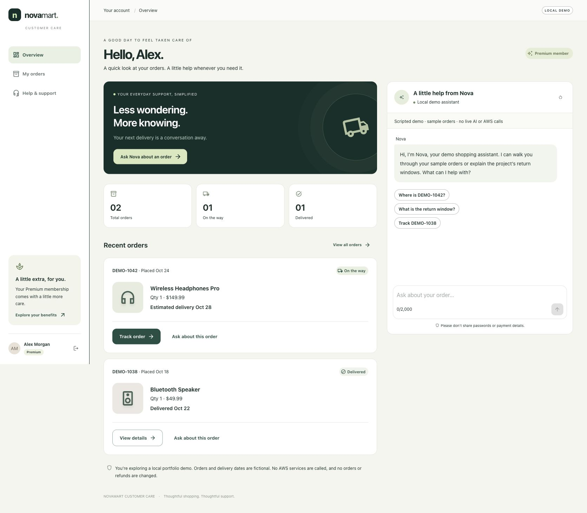

# NovaMart customer portal

React + TypeScript + Material UI customer care for the existing NovaMart project. The UI runs locally. In the default **AgentCore mode**, its local Node backend calls the project's deployed AgentCore Runtime through the existing Python `invoke_agent()` adapter. Customer and order records come from the project's DynamoDB tables. No AWS services are created or deployed by the frontend.

## Start with the real project agent

Prerequisites: Node.js 22.12+, the project's Python virtual environment and dependencies, valid local AWS credentials for the existing deployment, and the populated root `.env` containing its deployment identifiers. No AWS keys enter the browser.

From the repository root:

```bash
cd frontend
npm ci
npm run setup:account -- owner@novamart.local CUST-001
npm run api
```

`setup:account` creates two **gitignored, owner-readable local files** without calling AWS:

- `.portal.env`: local login email, server-authorized customer ID, and salted scrypt password hash.
- `.portal-password`: generated password to read locally and use for login. Never commit or share it.

The email is a local login name, not a Cognito account or email verification. Choose an existing project customer that you are authorized to access. The setup command refuses to overwrite existing account files. This is a single-owner local development portal, not production customer authentication.

In another terminal:

```bash
cd frontend
npm run dev -- --strictPort
```

Open **http://127.0.0.1:5173**, sign in using the configured login name and generated password, and check for the **LIVE AGENT** badge. Login reads the mapped customer from DynamoDB; invalid/expired AWS credentials or a nonexistent customer cause an explicit error instead of showing sample data.

If the old demo API is still running on port 3001, stop it with Ctrl+C in its terminal before starting `npm run api`. Starting an additional process does not replace the old one. The Vite app automatically obtains the backend mode from `/api/config`.

The API binds to **127.0.0.1:3001**; Vite proxies `/api` to it. Keep frontend port 5173, or update the backend's allowed origins explicitly. By default, the bridge uses the repository's `.venv/bin/python`; set `PORTAL_PYTHON` server-side if the virtual environment is elsewhere. The Python process loads the existing root project configuration and uses the normal local AWS SDK credential chain.

## Request flow

1. Login validates the private local credential, then loads the server-mapped project customer.
2. The API issues a random HttpOnly, SameSite=Strict cookie with 30-minute expiry.
3. `/api/orders` queries only the configured customer partition in DynamoDB, including pagination.
4. `/api/chat` sends the message and a server-scoped conversation ID to `src/portal_bridge.py`.
5. The bridge calls **the existing `src/agent_orchestrator.py::invoke_agent()`**, which invokes your deployed AgentCore Runtime and its existing multi-agent workflow.
6. The bridge returns the runtime's `result` as chat text. Failed invocations return an error; there is **no fallback to scripted answers**.

The server ignores browser-supplied customer IDs. Conversation IDs are additionally scoped to the login so another login cannot select the same WorkflowState by reusing a browser conversation ID. Concurrent turns for one conversation are rejected while an invocation is running.

Live requests use AWS inference and can write the agent's DynamoDB WorkflowState. Responses and routing are determined by your existing deployed agent, prompts, tools, guardrails, and policies. These are unchanged. The portal does not implement payments, refunds, conversation recall, or new carrier integrations. A stable session ID does not add conversational recall that the original agent lacks. Failed/aborted HTTP requests can still have reached AWS; retrying is not a rollback.

Order cards display recorded values only. The table's `estimated_delivery` is labeled an estimate, not an actual delivery timestamp. Missing fields show **Not recorded**. No shipment events, addresses, or delivery history are fabricated: the project table does not contain a carrier event timeline.

## Optional offline demo

```bash
npm run api:demo
```

This explicitly selects the old scripted provider, uses fictional `DEMO-*` records, and makes no AWS calls. It shows **LOCAL DEMO** and exposes **Fill demo credentials** (`demo@novamart.local` / `NovaMartDemo!`). Those public credentials are rejected by the live provider. Run only one API mode at a time.

These earlier previews show **demo mode**, not proof of live inference:



[Demo mobile layout](docs/portal-mobile.jpg)

## Structure

```text
frontend/src/
  app/                     # Composition root, shared theme, dashboard, error boundary
  components/              # Brand and responsive navigation
  features/auth/           # Authentication context and login
  features/orders/         # Query hook, order cards, recorded tracking details
  features/chat/           # Conversation state and chat presentation
  services/                # PortalService contracts and same-origin HTTP adapter
frontend/server/
  app.mjs                  # Cookie sessions, request validation, provider injection
  project-provider.mjs     # Live provider and bounded Python subprocess adapter
  data.mjs                 # Optional scripted demo provider data
  setup-account.mjs        # Private local account generation (no AWS calls)
src/portal_bridge.py        # Server-only project Runtime and DynamoDB adapter
```

Views depend on feature hooks and the typed `PortalService` contract. The HTTP adapter implements that port; tests inject fakes. The local server separately accepts a provider, so live and demo behavior remain explicit. Existing Python agent code is reused without changing its business logic. The dashboard is loaded lazily, and all user/model text renders as plain text rather than HTML.

## Security boundary

This is loopback-only, single-owner development software. It is not a production multi-customer authorization system. The existing agent's tools accept customer identifiers generated by the model; mapping identity in the portal prevents request-field forgery but does not turn model prompts into an authorization boundary. Before making it publicly accessible, enforce trusted customer/order authorization inside the agent's data tools, adopt production authentication, HTTPS and Secure cookies, durable session storage, and appropriate privacy controls. Do not expose the development servers publicly.

The root project `.env` stays server-side and is not copied into the browser bundle. Never put AWS secrets or the local password/hash into `VITE_*` variables. The bridge captures SDK output privately and returns generic errors instead of exposing credentials or raw AWS exceptions. Its subprocess has a bounded timeout and response-size limit. No automatic portal-level retry is performed.

## Checks

```bash
npm test                         # UI tests with injected services; no AWS
npm run test:api                  # Loopback API/provider tests with mocked bridge
npm run build                    # TypeScript validation and production bundle
npm run format:check
# From the repository root:
PYTHONDONTWRITEBYTECODE=1 .venv/bin/python tests/test_portal_bridge_offline.py
PYTHONDONTWRITEBYTECODE=1 .venv/bin/python tests/test_compatibility_offline.py
```

These offline checks establish the integration contract, not successful delivery of a live model response. No deployment, resource creation, or live model invocation is part of the test commands. Run an authorized request through the UI after starting the live backend to verify your current AWS deployment end to end.

`npm run preview` serves the static production bundle only and has no API proxy. Use the development commands above for the local portal. Hosting the built app requires a same-origin API/reverse proxy and production security controls.

## Latest offline verification

- UI tests: **9 passed**.
- Node API/provider/subprocess tests: **12 passed**.
- Python bridge tests: **6 passed**, with **0 AWS transport attempts**.
- Existing Python compatibility suite: **38 passed**, with **0 real AWS requests**.
- Restoration seed safety: **4 passed**.
- TypeScript/production build, formatting, Python syntax, and `git diff --check`: passed.
- Local `/api/config` confirms **agentcore** mode.


On November 2, the missing AWS foundation and Runtime were restored. Actual portal login and DynamoDB order loading returned HTTP 200 through the Vite proxy. The deployed agent returned the Premium 60-day return window and retrieved the delivered status of `ORD-59651`. The official Udacity suite passed **120/120**, and a fresh X-Ray trace contained the orchestrator, Inventory, and Communication agents. See [restoration details](../docs/RESTORATION.md).

The previews above remain demo screenshots. Browser automation was unavailable during restoration. Generated chat text can mislabel an estimated delivery date; the structured order view keeps its explicit estimated label. Memory recall and production customer authorization remain separate work.
